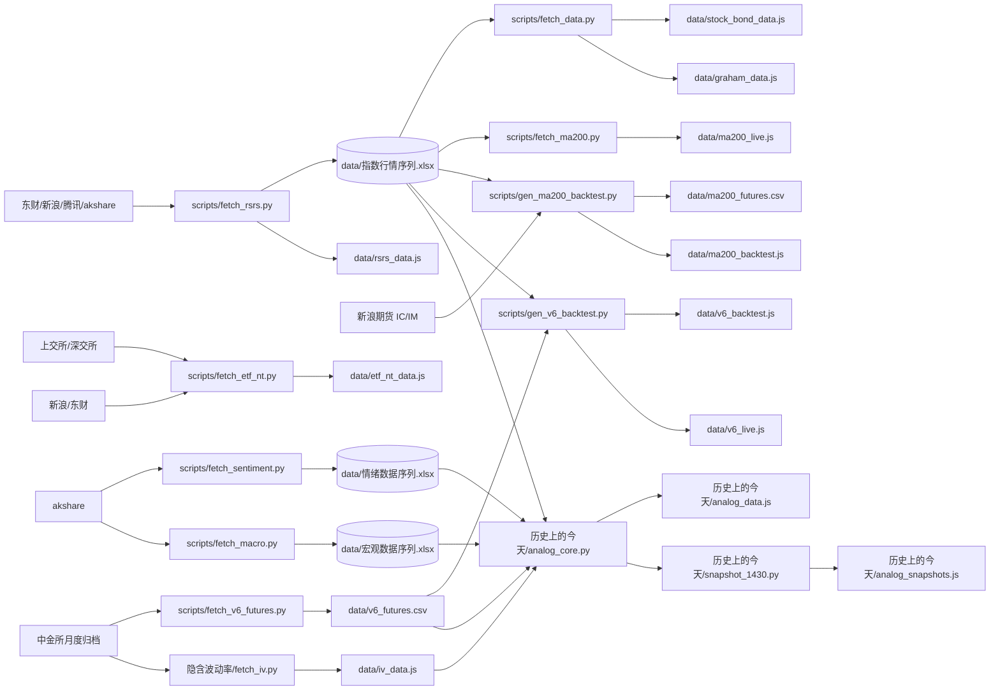

# 量化择时网站 · 项目说明

> 版本：2026-11-24（对应提交 `5d3256e`）
> 本文档面向第一次接触本仓库的开发者，说明每个网页做什么、怎么实现、数据从哪来、如何自动更新，以及本地如何运行和排错。

---

## 1. 项目概览

这是一个**纯静态、无后端**的量化择时网站：

- 页面全部是普通 HTML + 原生 JavaScript，图表使用 ECharts 5.5.0（CDN 引入）。
- 所有行情/指标/回测结果由 Python 脚本提前算好，写成 `data/*.js` 中的 `window.XXX_DATA` 全局变量，页面用 `<script src>` 直接加载。这样不需要 `fetch()`，可以直接双击打开或部署到任意静态服务器。
- 数据由 **GitHub Actions 每日定时抓取、计算、提交回仓库并部署到 GitHub Pages**。
- 交易日 14:25 额外有一个盘中快照任务，为「历史上的今天」页提供当日实时概率。

### 1.1 页面一览

| 页面 | 文件 | 核心内容 | 数据来源文件 | 盘中实时 |
|---|---|---|---|---|
| 首页 | `index.html` | 7 个功能页入口与简介 | 无 | 否 |
| 股债性价比 | `stock_bond.html` | 4 个宽基指数的股债性价比与 5 年分位 | `data/stock_bond_data.js` | 否 |
| 格雷厄姆指数 | `graham.html` | 4 个宽基指数的格雷厄姆指数与 5 年分位 | `data/graham_data.js` | 否 |
| RSRS 择时 | `rsrs.html` | 4 种 RSRS 策略回测对比与盘中预测值 | `data/rsrs_data.js` + `js/rsrs_realtime.js` | 加载页面时估算一次 |
| 吃贴水 | `earn_discount.html` | IC/IM 近月吃贴水 + 200 日均线择时 | `data/ma200_backtest.js`、`data/ma200_live.js` + `js/ma200_realtime.js` | 加载页面时估算一次 |
| 基差轮动（V6） | `v6_basis.html` | IH/IF/IC/IM 全月份合约基差轮动回测与实时持仓 | `data/v6_backtest.js`、`data/v6_live.js` + `js/v6_realtime.js` | 交易时段每分钟 |
| 国家队 ETF | `etf_nt.html` | 国家队持仓 ETF 份额变化、占比与十大持有人 | `data/etf_nt_data.js` | 否 |
| 历史上的今天 | `历史上的今天/analog.html` | 8 维市场状态匹配历史相似日，推算未来上涨概率 | `历史上的今天/analog_data.js`、`analog_snapshots.js` + `analog.js` | 14:25 快照，页面展示 |

### 1.2 技术栈

- 前端：HTML5、原生 JavaScript（ES5 风格）、ECharts 5.5.0、单份共享样式 `css/style.css`（各页另有内联样式）。
- 数据：Python 3.13、pandas、numpy、akshare（CI 固定 `1.20.39`）、requests、openpyxl。
- 部署：GitHub Actions + GitHub Pages。
- 无数据库、无服务端进程。

---

## 2. 目录结构

```text
择时网页_trae_deepseek/
├─ index.html                     # 首页
├─ stock_bond.html                # 股债性价比
├─ graham.html                    # 格雷厄姆指数
├─ rsrs.html                      # RSRS 择时
├─ earn_discount.html             # 吃贴水（IC/IM + 200 日均线）
├─ v6_basis.html                  # 股指期货基差轮动 V6
├─ etf_nt.html                    # 国家队 ETF 看板
├─ css/style.css                  # 全站共享样式
├─ js/
│  ├─ rsrs_realtime.js            # RSRS 盘中预测值
│  ├─ ma200_realtime.js           # 吃贴水实时持仓与图表
│  └─ v6_realtime.js              # V6 实时排名、调仓建议与全部图表
├─ data/                          # 线上数据（生成的 JS + 原始 CSV/JSON/XLSX）
├─ 隐含波动率/
│  ├─ fetch_iv.py                 # MO 期权反算中证1000隐含波动率
│  └─ iv_history.csv              # 隐含波动率历史缓存
├─ 历史上的今天/
│  ├─ analog.html / analog.js     # 页面与渲染逻辑
│  ├─ analog_core.py              # 相似日模型 + 回测校准
│  ├─ snapshot_1430.py            # 14:25 盘中快照
│  ├─ analog_data.js              # 生成数据
│  ├─ analog_snapshots.js         # 盘中快照数据
│  └─ cache/price_patch.csv       # 腾讯日K补洞缓存
├─ scripts/                       # CI 使用的数据/回测脚本
├─ research/                      # 研究性脚本与结果（不参与部署）
│  └─ outputs/
├─ docs/                          # 策略与指令文档
├─ archive/                       # 归档：废弃指标、草稿、旧脚本
├─ .github/workflows/deploy.yml   # 每日更新 + Pages 部署
└─ .gitignore
```

> 页面必须保留在仓库根目录（`历史上的今天/` 除外，用的是相对路径），因为页面里写死了 `css/`、`js/`、`data/` 的相对路径。

---

## 3. 快速开始

### 3.1 本地预览（只看页面）

```bash
cd 择时网页_trae_deepseek
python -m http.server 8000
# 浏览器打开 http://localhost:8000/
```

- 也可以直接双击 HTML 打开，但因为数据是 JS 全局变量，不依赖 `fetch()`，通常可以正常显示。
- ECharts 来自 `cdn.jsdelivr.net`，离线环境需要把 ECharts 下载到本地并改引用。
- 建议用 HTTP 服务方式预览，避免浏览器对本地文件的限制。

### 3.2 本地重新生成全部数据

```bash
python -m pip install pandas numpy "akshare==1.20.39" requests openpyxl
```

按以下顺序执行（与 CI 一致）：

```bash
python scripts/fetch_rsrs.py          # 更新指数行情 xlsx，生成 RSRS 数据
python scripts/fetch_data.py          # 生成股债性价比、格雷厄姆数据
python scripts/fetch_ma200.py         # 生成吃贴水实时活数据
python scripts/gen_ma200_backtest.py  # 更新期货序列并生成吃贴水回测
python scripts/fetch_v6_futures.py    # 抓取中金所全月份合约日行情
python scripts/gen_v6_backtest.py     # 生成 V6 回测与实时持仓数据
python scripts/fetch_etf_nt.py        # 生成国家队 ETF 看板数据
python scripts/fetch_sentiment.py     # 生成情绪数据（供相似日模型）
python scripts/fetch_macro.py         # 生成宏观数据（手动运行，CI 不调用）
python 隐含波动率/fetch_iv.py          # 生成隐含波动率（当前页面未接入）
python 历史上的今天/analog_core.py      # 生成历史上的今天主数据
python 历史上的今天/snapshot_1430.py    # 可选：生成盘中快照
```

常用环境变量：

| 变量 | 作用 | 默认 |
|---|---|---|
| `MA200_FUT_DIR` | 覆盖期货原始数据目录 | 本机 `D:\ipynb\长期数据\sqlite\股指期货_期权`，否则仓库 `data/` |
| `MA200_IDX_FILE` | 覆盖指数 xlsx 路径 | 同上逻辑 |
| `IV_RATE` | 期权隐含波动率反算使用的无风险利率 | `0.015` |
| `IV_FULL` | 设为 `1` 时强制全量重算 IV | 未设置（增量） |

---

## 4. 页面详解

### 4.1 首页 `index.html`

- 职责：导航与项目介绍，列出 7 个功能页入口。
- 实现：纯静态 HTML + `css/style.css`，无 JS 逻辑、无数据依赖。
- 顶部导航在每个页面重复出现，新增页面时需要同步修改所有页面的 `<nav>`。

### 4.2 股债性价比 `stock_bond.html`

**目的**：比较股票（用指数 PE 代表）与 10 年期国债的 relative 吸引力，数值越大表示股票越便宜。

**指标定义**（在 `scripts/fetch_data.py` 中计算，前端只画图）：

```text
股债性价比 = (1 / PE_TTM) × 100 − 10年期国债收益率(%)
5年分位数  = (当前值在近5年样本中的升序排名 − 1) / (样本数 − 1)
```

- 覆盖上证 50、沪深 300、中证 500、中证 1000。
- PE 为月频数据（中证指数公司口径），因此曲线整体是月频；收盘价与国债为日频，按日期对齐。
- 5 年分位使用滚动窗口，窗口内至少要有足够样本才输出。

**前端实现**（`stock_bond.html` 内联脚本）：

- 每个指数一张 500px 高的 ECharts 图，共 4 张。
- 单 grid、三个 Y 轴：
  - 左轴：股债性价比；
  - 右轴（offset 0）：指数收盘价；
  - 右轴（offset 50，范围 0~1）：5 年分位。
- 三条 series：性价比折线、分位折线（带浅色面积）、收盘价折线。
- 两条 `markLine` 分别标注最新性价比与最新分位，并显示数值。
- `dataZoom` 同时提供 `inside`（滚轮/拖拽）与 `slider`（底部滑块）。
- 图表标题自动追加数据区间。
- 页面顶部有数据状态条：`data_status.stale=true` 时显示橙色警告，说明 PE/收盘/国债/期货日历各自的最新日期；否则显示绿色“数据完整”。

**数据字段**（`window.STOCK_BOND_DATA[指数]`）：

`dates`、`stock_bond_spread`、`percentile`、`close`、`latest_stock_bond_spread`、`latest_percentile`、`data_status`、`data_source`。

### 4.3 格雷厄姆指数 `graham.html`

与股债性价比页面结构完全一致，仅指标与文案不同：

```text
格雷厄姆指数 = (1 / PE_TTM) × 100 / 10年期国债收益率(%)
```

- 数值越大表示股票相对债券越有吸引力。
- 图上 markLine 保留 4 位小数。
- 数据来自 `data/graham_data.js`（`window.GRAHAM_DATA`），同样由 `scripts/fetch_data.py` 生成。

> 注意：首页卡片文案与 `docs/指令1.md` 里把公式写成了“10年期国债收益率 / PE_TTM”，与当前实现 `(1/PE) / 收益率` 不一致。**以本页与脚本实现为准。**

### 4.4 RSRS 择时 `rsrs.html`

**目的**：用阻力支撑相对强度（RSRS）构造择时信号，对比 4 种改进版本的回测表现，并在盘中给出当日预测值。

**数据生成**：`scripts/fetch_rsrs.py` → `data/rsrs_data.js`（`window.RSRS_DATA`）。

#### 指标公式

对每个交易日，取最近 N 日的高价 `H` 与低价 `L` 做 OLS 回归：

```text
beta = Cov(H, L) / Var(L)
R²   = Cov(H, L)² / (Var(L) × Var(H))
z    = (beta_t − mean(beta, M)) / std(beta, M)
```

成交额加权版本用当日成交额归一化作为权重，计算加权协方差/方差。

四种信号：

```text
RSRS_原始          = z × R²
RSRS_右偏修正      = z × R² × beta
RSRS_钝化          = z × R²^(4 × ret_q)
RSRS_成交额加权钝化 = z_w × R²_w^(4 × ret_q)
```

其中 `ret_q` 是 N 日收益率标准差在最近 M 日窗口内的滚动分位（0~1），用于在市场波动大时钝化信号。

#### 参数与回测

- 每个指数独立参数（`params.N`、`params.M`、`params.ths`）：

| 指数 | N | M | 四种策略阈值 |
|---|---|---|---|
| 上证 50 | 16 | 700 | 0.6 / 0.6 / 0.3 / 0.8 |
| 沪深 300 | 18 | 600 | 0.7 / 0.7 / 0.7 / 0.8 |
| 中证 500 | 18 | 800 | 0.8 / 0.8 / 1.0 / 0.6 |
| 中证 1000 | 19 | 800 | 0.8 / 0.8 / 0.7 / 0.5 |

- 交易规则：`signal > +阈值` 开仓（满仓），`signal < −阈值` 平仓（空仓），中间维持原状态（滞回）。
- 单边手续费 `0.001`（千分之一）。
- 绩效：年化收益、夏普（无风险利率 3%）、最大回撤、交易次数，基准为买入持有。
- 回测区间从各指数数据起点开始，取数据文件内全部历史。

#### 页面展示

- 每个指数一张 520px 图，**两个 grid**：
  - 上图：买入持有基准 + 4 条策略净值曲线；净值末端 `markPoint` 显示“满仓/空仓”。
  - 下图：4 条 RSRS 指标曲线 + 各自的 `±阈值` 虚线。
- 图下方文字显示最新日期、各策略最新指标值与阈值。
- 性能表列：策略、年化收益、基准收益、夏普、最大回撤、交易次数、最新指标、预测值、阈值、当前/截至。
- `dataZoom` 同时控制上下两个 grid。

#### 盘中预测（`js/rsrs_realtime.js`）

- 读取 `RSRS_DATA[指数].ohlc`（最近约 430~870 个交易日的高/低/收/量）。
- 用东方财富 `push2.eastmoney.com/api/qt/stock/get` 获取当日实时价、最高、最低、成交量；10 秒超时；失败回退腾讯 `qt.gtimg.cn` JSONP。
- 把当日实时 K 线拼接到历史序列末尾，重新计算四种 RSRS 最新值，写入表格“预测值”列。
- 时间判断（北京时间）：
  - 09:30 前：盘前，直接用文件最后一个信号；
  - 09:30–15:00：盘中估算；
  - 15:00 后：视为已收盘，用文件信号；
  - 实时时间戳不是今天（休市）：用文件信号。
- **没有定时器，只在页面加载时计算一次**，刷新页面才会更新。
- `data_status.stale=true` 的指数不请求行情，预测列显示“数据缺失”，并提示缺几个交易日。
- 预测值着色：大于阈值红色（满仓）、小于负阈值绿色（空仓）、其余灰色。

### 4.5 吃贴水 `earn_discount.html`

**目的**：做多 IC（中证 500 股指期货）/ IM（中证 1000 股指期货）近月合约，赚取贴水收敛收益，并用 200 日均线控制长期趋势风险。

**数据生成**：

- `scripts/gen_ma200_backtest.py` → `data/ma200_backtest.js`（历史回测）+ `data/ma200_futures.csv`（近月合约日序列）；
- `scripts/fetch_ma200.py` → `data/ma200_live.js`（实时活数据：最近 430 日现货、快照与参数）；
- 共享逻辑库 `scripts/backtest_trend_methods.py`（换月、趋势确认、成本、回测）。

#### 策略规则

1. 每个品种只持有**近月合约**：距到期 > 5 个自然日、成交量 > 0、到期日最近；到期日取第三个周五，若已到期则用最后交易日。
2. 趋势：`收盘价 > MA200` 为原始多头信号；新方向必须**连续 5 个交易日**成立才确认，否则维持原状态（防抖动）。
3. 低波动：`vol60 = std(日收益, 60) × √242`；`低波动 = vol60 < 最近 252 日 vol60 的中位数`（至少 126 个观测）。
4. 目标权重表：

| 趋势组合 | 波动组合 | IC 权重 | IM 权重 | 总敞口 |
|---|---|---|---|---|
| 双强 | 双低波 | 0.60 | 0.60 | 1.20 |
| 双强 | 非双低波 | 0.50 | 0.50 | 1.00 |
| IC 强 / IM 弱 | — | 0.75 | 0.25 | 1.00 |
| IC 弱 / IM 强 | — | 0.25 | 0.75 | 1.00 |
| 双弱 | — | 0.125 | 0.125 | 0.25 |

5. 成本：权重变动成本 `0.0002 × Σ|Δw|`；换月成本 `2 × 0.0002 × Σ(w × roll)`（单边 2bp，换月双向约 4bp）。
6. 信号滞后：回测净值 `NAV_LAG=1` 个交易日。
7. 评价期：`2023-05-04` 至最新交易日，基准为中证 1000 买入持有。

#### 页面展示

- **当前持仓建议**：显示趋势、低波动、目标权重；盘中用实时价重算两腿状态与权重。
- **回测净值图**：2 个 grid、3 个 Y 轴：
  - 策略净值、中证 1000 基准、策略/基准相对净值（右轴）；
  - 下方为历史总敞口阶梯线（0~1.3），并画 `y=1` 参考线。
- **最新现货数据**：数据文件更新日的收盘、MA200、趋势、波动状态。
- **策略逻辑说明 + 参数配置表**：参数由数据文件提供，前端渲染。
- 刷新时保留用户当前的 `dataZoom` 区间。

#### 盘中实时（`js/ma200_realtime.js`）

- 东方财富实时价（10 秒超时）→ 腾讯 JSONP 兜底；两腿只要有一条失败就不切换实时快照。
- 实时价拼接最近 430 日收盘，重新算 MA200、确认趋势、60 日波动与权重。
- **没有定时器**，只在页面加载/刷新时重算。页面文案中的“每 30 分钟更新”与实现不符。
- `data_status.stale=true` 时：持仓标签显示“数据缺失”，权重与两腿状态显示 `—`，图表标题标注“现货缺失，已截止 …”，不给出持仓建议。

### 4.6 股指期货基差轮动（V6）`v6_basis.html`

**目的**：在 IH/IF/IC/IM 全部在挂月份合约中，做多年化基差率最低（贴水最深）的合约、做空年化基差率最高（升水最高）的合约，每月末调仓，赚取基差收敛/轮动收益。

**数据生成**：

- `scripts/fetch_v6_futures.py` → `data/v6_futures.csv`（全部月份合约日收盘长表）；
- `scripts/gen_v6_backtest.py` → `data/v6_backtest.js`（`window.V6_BACKTEST`）+ `data/v6_live.js`（`window.V6_LIVE`）。

#### 核心公式

```text
年化基差率 b = (期货价 / 现货价 − 1) × 365 / 剩余自然日
```

- 现货：IH→上证 50、IF→沪深 300、IC→中证 500、IM→中证 1000。
- 候选池：调仓日有收盘价，且到期日 ≥ 下一个调仓日。
- 多头腿：`b` 最小且 `b ≤ −5%`；空头腿：`b` 最大且 `b ≥ +1%`；未达阈值的腿空仓，收益记 0。
- 两腿各 100% 名义本金（合计约 2 倍杠杆）。
- 调仓日：每月最后一个交易日；到期日为到期月第三个周五，遇非交易日顺延。
- **回测未计手续费、冲击成本、保证金利息、展期成本。**
- 当前数据规模：2134 个交易日、106 个持仓期（2026-11-24 数据）。

#### 页面展示

- **当前持仓建议**（左右两栏）：
  - 左：当前持仓期实际应持合约、调仓日年化基差与收盘、实时价、期间收益、累计盈亏；
  - 右：若今日调仓，按实时价重算的候选合约、年化基差、是否达阈值与建议；
  - 下方：全市场年化基差排名表（按实时价）。
- **历史业绩 KPI**：净值、年化、波动、夏普、最大回撤、月胜率等。
- **参数输入**：可修改多头阈值（默认 −5%）与空头阈值（默认 +1%），点击“重算”后：
  - 重新判断每个历史持仓期的两腿是否开仓；
  - 同步重算实时两腿建议；
  - 注意：**不会重新挑选历史合约**，只改变“是否参与”的判断，因为历史选中合约与基差已固化在数据文件里。
- **净值与回撤图**：上图净值曲线，下图为回撤（百分比）。
- **分年度收益柱状图**。
- **调仓明细表**：支持表头点击排序（#、调仓日、下个调仓日、做多/做空合约与基差、开仓腿、区间收益）。
- **收益拆解表**：按“腿 × 品种”统计次数、单期胜率、平均单期收益、累计收益。
- **策略规则说明与参数表**。

#### 盘中实时（`js/v6_realtime.js`）

- 东方财富 `push2.eastmoney.com/api/qt/ulist.np/get` 一次请求 16 个合约 + 4 个现货指数；12 秒超时；无腾讯兜底。
- 刷新节奏（北京时间）：
  - 09:30–11:30、13:00–15:00：每分钟（对齐整分钟，最小间隔 5 秒）；
  - 11:30–13:00：午休只重渲染；
  - 15:00–16:00：用 15:00 价再刷一次；
  - 16:00 后：定稿，不再更新。
- 请求失败时全部使用数据文件收盘价，并在价格后加灰色 `*`。
- `data_status.stale=true` 只显示警示横幅，实时排名仍按现价计算。

### 4.7 国家队 ETF 看板 `etf_nt.html`

**目的**：追踪中央汇金、社保基金、证金等“国家队”机构持有的 ETF 份额变化与十大持有人。

**数据生成**：`scripts/fetch_etf_nt.py` → `data/etf_nt_data.js`（`window.ETF_NT_DATA`）。

#### 数据来源与口径

- 标的池：`data/etf_nt_universe.json`，当前 46 只沪深 ETF。
- 份额：
  - 上交所 `query.sse.com.cn`（`TOT_VOL`，单位万份）；
  - 深交所 `szse.cn/api/report/ShowReport`（`dqgm`，当日快照，单位万份）；
  - 深市历史份额只能从部署日起逐日累积，无法回填。
- 价格：东方财富 `push2his` 主源，新浪 `quotes.sina.cn` 备源。
- 十大持有人：新浪基金披露接口，半年报/年报口径。
- 份额数据 T+1；持有人仅半年报/年报披露。
- 国家队关键词在 `NT_KEYWORDS` 中维护（中央汇金、社保、证金等子串匹配）。
- 国家队占比 = 十大持有人中国家队机构合计份额 ÷ 该报告期 ETF 总份额；只统计前十大持有人，因此是实际持仓的**下界**。
- 报告期只取 `06-30` 与 `12-31`。
- 缓存：持有人 30 天；价格 6000 根 K 线；份额历史从 2012-01-04 起。

#### 页面展示

- **总份额主图**：左轴为沪市国家队 ETF 合计份额（亿份），右轴为 510300 / 510500 / 512100 三只指数 ETF 收盘价（按所选区间首日=100 归一化）。
- **持仓占比图**：全部国家队 ETF 合计占比 + 三只指数 ETF 各自占比，横轴为报告期。
- **持仓明细表**：代码、名称、最新份额、1 日/1 周/1 月/3 月/1 年变化、国家队占比、持仓变化、报告期；表头点击排序，点击行跳转详情。
- **详情页**（`etf_nt.html?code=510300`）：价格与份额双轴图、十大持有人表（国家队行高亮，显示上期份额与变化）。
- 时间范围按钮：1 月 / 3 月 / 1 年 / 3 年 / 全部。
- 数据脚本动态加载并加 5 分钟时间戳，避免 Pages/CDN 缓存旧数据。

#### 命令行参数

```bash
python scripts/fetch_etf_nt.py            # 日常增量
python scripts/fetch_etf_nt.py --init     # 初始化/回填份额历史
python scripts/fetch_etf_nt.py --rescan   # 重新扫描标的池
python scripts/fetch_etf_nt.py --holders   # 强制更新十大持有人
python scripts/fetch_etf_nt.py --skip-holders
python scripts/fetch_etf_nt.py --no-fetch  # 只用已有 CSV 重新生成 JS
```

### 4.8 历史上的今天 `历史上的今天/analog.html`

**目的**：把当前市场状态拆成 8 个维度，在历史中寻找最相似的交易日，用这些相似日之后的真实走势，推算未来 5/10/20/60/120/240 个交易日的上涨概率、涨跌空间与概率锥。

**数据生成**：

- `历史上的今天/analog_core.py` → `analog_data.js`（`window.ANALOG_DATA`）；
- `历史上的今天/snapshot_1430.py` → `analog_snapshots.js`（`window.ANALOG_SNAPSHOT`，14:25 盘中快照）。

#### 8 个状态维度与权重

| 维度 | 权重 | 主要特征 |
|---|---|---|
| trend 趋势 | 0.30 | `c/MA20−1`、`c/MA60−1`、`c/MA200−1`、`MA60/MA60.shift(20)−1` |
| momentum 动量 | 0.12 | 20 日、60 日收益 |
| vol 波动 | 0.18 | 20 日已实现波动、`rv5/rv60`；中证 1000 额外加入 `iv30` |
| valuation 估值 | 0.15 | PB、PE（月频，按发布滞后 45 天对齐）、股债利差 |
| sentiment 情绪 | 0.10 | 融资余额 20 日变化、融资净买入/余额、50ETF 波指 QVIX |
| volume 量能 | 0.05 | 5 日均量 / 60 日均量 |
| macro 宏观 | 0.05 | M1−M2、PMI、PPI−CPI（滞后 45 天对齐） |
| basis 基差 | 0.05 | 最近未到期合约年化基差 |

每个特征在块内做滚动 Z-score（窗口 `Z_WIN=750`），截断到 [−1, 1]；块内缺失特征不参与距离计算。

#### 相似日与概率

1. 距离：块内“双方均非缺失”特征的均方误差，按块权重加权；`normalize=True` 时再除以该块候选区中位数。
2. 候选：只能使用 `idx ≤ t − max(25, h)` 的历史日，避免用到未来数据。
3. 选邻居：按距离取前 `TOPK=200`；权重

```text
w = exp(−d / (2 × median(d[:300]))) × 0.5^((t − s) / 2000)
```

并归一化；有效样本数 `n_eff = 1 / Σw²`。代码中时间衰减半衰期实际为 2000 日（输出字段 `method.decay_halflife` 写的是 968，属展示不一致）。

4. 波动率归一：历史收益乘以 `clip(σ_t / σ_s, 0.35, 2.5)`，把不同波动环境下的涨跌幅拉到同一尺度。
5. 原始概率 `p_raw = Σ w × 1(ret > 0)`；用基准上涨率 `p_base` 做收缩：

```text
n_indep = max(n_eff × min(1, 20/h), 1)
λ       = 30 / (30 + n_indep)
p_up    = (1 − λ) × p_raw + λ × p_base
```

6. 90% 置信区间用 Beta 方差近似；同时输出加权分位 q10~q90、上涨/下跌条件均值、赔率、MFE/MAE 分位、逐日概率锥。
7. 交叉验证：
   - 蒙特卡洛：EWMA（λ=0.94）残差自举 3000 次，seed=20260101，最近 1500 日；
   - 隐含波动率：用 `data/iv_data.js` 的年化 IV 换算到 h 期，给出 ±1.2816σ 区间；超过 12 天视为过期。
8. 回测校准：2016-01-04 起每 5 个交易日滚动一次，输出 Brier、基准 Brier、80% 区间覆盖率与宽度、高/低概率命中率、可靠性分箱。

#### 数据字段

`ANALOG_DATA[指数]` 包含：

- `date`、`close`、`first_date`、`n_days`、`price{dates, close}`（约 5315 点）；
- `blocks`、`block_nb`、`block_last`（8 个维度的当前 Z 值）；
- `horizons[5/10/20/60/120/240]`：`p_up`、`p_raw`、`p_base`、`ci90`、`n_eff`、`exp_ret`、`q10~q90`、`up_mean`、`down_mean`、`odds`、`mfe`、`mae`、`win_rate`、`hist`、`fan`、`neighbors`、`disp`、`cross{mc, iv}`；
- `backtest`：各期限的概率序列、实际结果、Brier、覆盖率、分箱可靠性。

#### 页面展示

- 指数与期限切换按钮；KPI 卡片（上涨概率、90% 区间、中位涨幅、赔率、涨跌均值、分位区间）。
- **概率锥**：q10~q90、q25~q75 带状区域 + 中位路径 + 50 条历史相似路径（时间分散）。
- **历史走势图**：收盘价 + 示例路径起点散点 + 权重最高相似日散点。
- **8 个分块小图**：各维度当前状态。
- **末段收益条件分布**：按相似度与时近加权的柱状分布。
- **最相似交易日表**：日期、距离、权重、此后收益、迷你走势。
- **方法对照表**：相似日 / 蒙特卡洛 / 期权隐含三种口径。
- **当前状态分解表**：8 个块的 Z 值。
- **概率校准图**与概率/实际结果时间序列。
- **推算方法说明**折叠面板。

#### 盘中快照机制

- GitHub Actions 单独 job `snapshot-1430`，工作日北京时间 14:25 运行。
- 用东方财富实时价（腾讯兜底）构造“今日”临时 K 线，调用 `analog_core.build_context()` 重算概率，写入 `analog_snapshots.js`。
- **绝不写回 xlsx 与 `price_patch.csv`**，避免污染历史数据。
- 页面加载时若快照日期晚于主数据日期，则用快照更新 KPI、状态栏、指数涨跌幅与走势图末点；概率锥、相似日表、分布图仍读取主数据文件，因此盘中不会整体重算。
- 14:25 任务失败时保留上一份快照。

---

## 5. 数据管道

### 5.1 总览



### 5.2 脚本清单

| 脚本 | 作用 | 输入 | 输出 | CI |
|---|---|---|---|---|
| `scripts/fetch_rsrs.py` | 增量维护指数行情 xlsx，计算 RSRS 与回测 | 5 个行情源、PE、国债 | `data/指数行情序列.xlsx`、`fetch_status.json`、`rsrs_data.js` | 是（第 1 步） |
| `scripts/fetch_data.py` | 股债性价比、格雷厄姆指数与分位 | xlsx、`fetch_status.json`、`ma200_futures.csv` | `stock_bond_data.js`、`graham_data.js` | 是（第 2 步） |
| `scripts/fetch_ma200.py` | 吃贴水实时活数据 | xlsx、`ma200_futures.csv` | `ma200_live.js` | 是（第 3 步） |
| `scripts/gen_ma200_backtest.py` | 维护近月合约序列，生成吃贴水回测 | `ma200_futures.csv`、xlsx、新浪期货 | `ma200_futures.csv`、`ma200_backtest.js` | 是（第 4 步） |
| `scripts/backtest_trend_methods.py` | 换月/趋势/成本/回测逻辑库 | 无（被上面脚本 import） | 无 | 间接 |
| `scripts/fetch_v6_futures.py` | 抓中金所全月份合约日行情 | 中金所归档 zip | `v6_futures.csv` | 是（第 5 步，允许失败） |
| `scripts/gen_v6_backtest.py` | V6 基差轮动回测与实时持仓 | `v6_futures.csv`、xlsx | `v6_backtest.js`、`v6_live.js` | 是（第 6 步） |
| `scripts/fetch_etf_nt.py` | 国家队 ETF 份额/价格/持有人 | universe、CSV、交易所接口 | `etf_nt_data.js` | 是（第 7 步，允许失败） |
| `scripts/fetch_sentiment.py` | 两融、QVIX、派生市场行情 | akshare、xlsx | `情绪数据序列.xlsx` | 是（第 8 步，允许失败） |
| `scripts/fetch_macro.py` | 9 个月频宏观指标 | akshare | `宏观数据序列.xlsx` | **否，手动运行** |
| `隐含波动率/fetch_iv.py` | MO 期权反算中证 1000 IV | 中金所归档、`iv_history.csv` | `iv_data.js`、`iv_history.csv` | 是（第 9 步，允许失败） |
| `历史上的今天/analog_core.py` | 相似日模型、概率、校准回测 | xlsx、情绪/宏观/IV/基差 | `analog_data.js` | 是（第 10 步，允许失败） |
| `历史上的今天/snapshot_1430.py` | 14:25 盘中快照 | 实时行情、上下文 | `analog_snapshots.js` | 独立 job |

### 5.3 关键脚本细节

#### `scripts/fetch_rsrs.py`

- 全球数据源回退顺序（每个源重试 3 次、间隔 10 秒、单次超时 25 秒）：
  1. `ak.stock_zh_index_daily_em`（东方财富）
  2. 东方财富 HTTP `push2his.eastmoney.com`
  3. `ak.stock_zh_index_daily`（新浪）
  4. 腾讯 HTTP `web.ifzq.gtimg.cn`
  5. `ak.stock_zh_index_daily_tx`
- PE：`ak.stock_index_pe_lg(symbol=中文名)`（乐咕乐股，月频）。
- 10 年期国债：`ak.bond_zh_us_rate()` 取“中国国债收益率 10 年”。
- 增量更新：从 `最后日期 − 5 天` 开始拉取，覆盖修订；按日期去重保留最后一条。
- 盘中保护：北京时间 15:00 前，丢弃当日行并删除 xlsx 中残留的当日行。
- 数据质量：用 `ma200_futures.csv` 的交易日历比对，缺日数写入 `data_status.missing_days`。
- 输出 `fetch_status.json`，记录各指数最后日期、PE 日期、国债日期，供后续脚本判断数据完整性。

#### `scripts/fetch_data.py`

- 从 xlsx 的各 sheet 读取收盘价、PE，计算两个指标与滚动 5 年分位。
- 分位公式：`(rank − 1) / (n − 1)`，窗口按日期滚动 5 年。
- 自动判断 PE 是月频还是日频（相邻间隔中位数），写入 `data_status.pe_frequency`。
- 数据陈旧判定：比较 PE、收盘、国债、期货日历四者的最新日期，生成 `stale`、`detail` 文案。

#### `scripts/gen_ma200_backtest.py` + `backtest_trend_methods.py`

- 全量回填起点：2022-01；之后只增量拉取 `now−2 月 ~ now+4 月` 的合约，并回溯 12 天缓冲重算。
- 期货源：`ak.futures_zh_daily_sina(symbol=ICyymm)`。
- 近月选择：到期日 > 当前 + 5 天、成交量 > 0、到期日最近。
- 净值合成：`comb = w_ic × ret_ic + w_im × ret_im`，再扣权重变动成本与换月成本。
- 信号滞后 1 日；评价期从 2023-05-04 开始。

#### `scripts/fetch_v6_futures.py`

- 下载 `http://www.cffex.com.cn/sj/historysj/{yyyymm}/zip/{yyyymm}.zip`，解压 `{yyyymmdd}_1.csv`（GB2312）。
- 只保留 `IH/IF/IC/IM + 4 位数字` 的合约，剔除期权与合计行。
- 全量回填从 2017-12 开始；增量回补最近 3 个月；本月下载失败则保留原文件。
- 去重键：`(date, contract)`，保留最后一条。

#### `scripts/gen_v6_backtest.py`

- 常量：`FACTOR=365`、`ANN=252`、`START=2018-01-01`、多头阈值 `-5%`、空头阈值 `+1%`。
- 生成月末调仓日历；合约收益用 `ffill` 后 `pct_change`。
- 输出 KPI：净值、年化、波动、夏普、最大回撤、月度胜率、分年度、按腿/品种归因。
- 同时输出实时数据：在挂合约、现货价、月末日历、上一持仓期信息与累计净值。
- 会与 `docs/V6策略说明文档.md` 中的“金标准”（净值 5.187 等）对比打印偏差。

#### `scripts/fetch_etf_nt.py`

- 上交所份额：`query.sse.com.cn`，字段 `TOT_VOL`（万份）；失败用 `curl` 兜底。
- 深交所份额：`szse.cn/api/report/ShowReport`，字段 `dqgm`（万份），仅当日快照。
- 价格：东方财富 `push2his` 主源、新浪备源，最多 6000 根。
- 持有人：新浪 `getFundHolder` 接口 + 页面解析；30 天缓存。
- 份额历史从 2012-01-04 起，`--init` 每 500 天中途落盘，可断点续跑。
- 深市份额与价格要求北京时间 15:05 后再抓，避免盘中不完整数据。

#### `scripts/fetch_sentiment.py`

- 两融：`ak.macro_china_market_margin_sh/_sz`；融资买入额/余额为沪+深合计。
- 波指：`ak.index_option_50etf_qvix`。
- 派生：融资净买入 = 融资余额差分；20 日均值。
- 输出 sheet：`两融`、`中国波指`、`市场行情`、`meta`；单个 sheet 失败时复用旧文件同 sheet。

#### `scripts/fetch_macro.py`

- 9 个宏观指标：M1/M2、央行总资产、新增信贷、社融、PMI、CPI、PPI、工业增加值、GDP。
- 日期解析兼容 `2026.7`、`2026年07月`、`202603`、`2026-08-01` 等格式。
- 每个指标一个 sheet，另有 `meta`；失败时按 sheet 回退旧文件。
- 下游 `analog_core.py` 读取 `货币供应量`、`PMI`、`PPI`、`CPI`。

#### `隐含波动率/fetch_iv.py`

- 用中金所 MO 期权结算价反算中证 1000 隐含波动率。
- 前向价 `F` 取同月 IM 期货“今结算”。
- Black-76 反解：二分 80 次，区间 `[1e-4, 3.0]`，先做无套利上下界校验。
- 过滤：`0.85F ≤ K ≤ 1.15F`、价格 ≥ 1、`0.01 < iv < 2.5`。
- ATM IV：按行权价线性插值到 `F`；30 日 IV：在最近两个到期日之间按方差插值。
- 缓存 `iv_history.csv`，增量只重算最近 3 个月。
- 输出 `data/iv_data.js`（`window.IV_DATA`）。当前**没有页面引用它**，属于预留给「历史上的今天」交叉验证的数据。

#### `历史上的今天/analog_core.py` 与 `snapshot_1430.py`

- 详见 4.8 节；补充数据质量控制：
  - 北京时间 15:05 后才把当日 bar 落盘；
  - 成交量量级跳变自动折算；
  - 月频数据按发布滞后 45 天对齐，最多向前填充 75 天；
  - 日频数据超过容忍窗口则置为缺失；
  - 腾讯日 K 补洞写入 `历史上的今天/cache/price_patch.csv`。

### 5.4 数据文件清单

| 文件 | 生产者 | 消费者 | 说明 |
|---|---|---|---|
| `data/指数行情序列.xlsx` | `fetch_rsrs.py` | 多个脚本 | 四指数 OHLCV + PE/PB + 国债；月频 PE |
| `data/fetch_status.json` | `fetch_rsrs.py` | `fetch_data.py`、工作流 | 各数据源最新日期与 `ok` 状态 |
| `data/rsrs_data.js` | `fetch_rsrs.py` | `rsrs.html` | 约 3.4MB，含 OHLC 与四种策略结果 |
| `data/stock_bond_data.js` / `graham_data.js` | `fetch_data.py` | 两个估值页 | 指标、分位、收盘、状态 |
| `data/ma200_futures.csv` | `gen_ma200_backtest.py` | 吃贴水相关脚本 | 近月合约日序列（IC/IM 收盘、收益、换月标记） |
| `data/ma200_backtest.js` | `gen_ma200_backtest.py` | `earn_discount.html` | 净值、基准、敞口、绩效 |
| `data/ma200_live.js` | `fetch_ma200.py` | `earn_discount.html` | 最近 430 日现货与快照 |
| `data/v6_futures.csv` | `fetch_v6_futures.py` | `gen_v6_backtest.py`、`analog_core.py` | 全月份合约日收盘 |
| `data/v6_backtest.js` | `gen_v6_backtest.py` | `v6_basis.html` | 2134 日收益序列、106 期调仓、KPI |
| `data/v6_live.js` | `gen_v6_backtest.py` | `v6_basis.html` | 在挂合约、现货、上一持仓期 |
| `data/etf_nt_universe.json` | 手工维护 | `fetch_etf_nt.py` | 46 只国家队 ETF 标的池 |
| `data/etf_nt_share.csv` | `fetch_etf_nt.py` | 同上 | 份额长表（code,date,share_yi） |
| `data/etf_nt_price.csv` | `fetch_etf_nt.py` | 同上 | 价格长表（code,date,close） |
| `data/etf_nt_holder.json` | `fetch_etf_nt.py` | 同上 | 十大持有人缓存 |
| `data/etf_nt_data.js` | `fetch_etf_nt.py` | `etf_nt.html` | 约 1.3MB 看板数据 |
| `data/情绪数据序列.xlsx` | `fetch_sentiment.py` | `analog_core.py` | 两融、QVIX、市场行情 |
| `data/宏观数据序列.xlsx` | `fetch_macro.py` | `analog_core.py` | 9 个宏观指标 |
| `隐含波动率/iv_history.csv` | `fetch_iv.py` | 同上 | IV 历史缓存（约 1050 行） |
| `data/iv_data.js` | `fetch_iv.py` | `analog_core.py` | IV 序列，页面暂未直接引用 |
| `历史上的今天/analog_data.js` | `analog_core.py` | `analog.html` | 约 1.5MB 主数据 |
| `历史上的今天/analog_snapshots.js` | `snapshot_1430.py` | `analog.html` | 14:25 盘中快照 |
| `历史上的今天/cache/price_patch.csv` | `analog_core.py` | 同上 | 腾讯日 K 补洞缓存 |

---

## 6. 盘中实时行情接口

三个实时脚本共用同一套思路：东方财富主源 + 腾讯兜底（V6 无兜底）。

| 脚本 | 主接口 | 兜底 | 频率 |
|---|---|---|---|
| `js/rsrs_realtime.js` | `push2.eastmoney.com/api/qt/stock/get` | `qt.gtimg.cn` JSONP | 页面加载一次 |
| `js/ma200_realtime.js` | `push2.eastmoney.com/api/qt/stock/get` | `qt.gtimg.cn` JSONP | 页面加载一次 |
| `js/v6_realtime.js` | `push2.eastmoney.com/api/qt/ulist.np/get` | 无 | 交易时段每分钟 |

- 东方财富字段：`f43` 最新价、`f44` 最高、`f45` 最低、`f46` 开盘、`f47` 成交量、`f48` 成交额、`f57/f58` 代码/名称、`f60` 昨收、`f86/f124` 时间戳。
- 腾讯字段：按 `~` 分割，`f[3]` 价、`f[33]` 高、`f[34]` 低、`f[6]` 量、`f[30]` 时间；GBK 编码。
- 超时：RSRS / MA200 为 10 秒，V6 为 12 秒。
- 失败处理：RSRS / V6 回退到文件收盘并在价格后标记；MA200 两腿任一失败则整体不切换实时快照。
- 时区：全部按北京时间判断盘前/盘中/收盘。

---

## 7. 自动化部署

工作流文件：`.github/workflows/deploy.yml`。

### 7.1 触发方式

| 触发 | UTC cron | 北京时间 | 说明 |
|---|---|---|---|
| 定时 | `30 8 * * *` | 16:30 | 收盘后主更新 |
| 定时 | `30 12 * * *` | 20:30 | 失败重试/补数据 |
| 定时 | `0 0 * * *` | 08:00 | 早间补漏 |
| 定时 | `25 6 * * 1-5` | 14:25（工作日） | 盘中快照（独立 job） |
| 手动 | `workflow_dispatch` | — | 手动触发 |
| 推送 | `push` 到 `main` | — | 代码更新后自动部署 |

并发控制：`group: pages-deploy`，`cancel-in-progress: false`（Pages 部署必须串行）。

### 7.2 两个 job

1. `build-and-deploy`（非 14:25 快照时运行）
   - 权限：`contents: read`、`pages: write`、`id-token: write`、`actions: read`。
   - Python 3.13；安装 `pandas numpy akshare==1.20.39 requests`。
   - 步骤顺序：`fetch_rsrs` → `fetch_data` → `fetch_ma200` → `gen_ma200_backtest` → `fetch_v6_futures`（允许失败）→ `gen_v6_backtest` → `fetch_etf_nt`（允许失败）→ `fetch_sentiment`（允许失败）→ `fetch_iv`（允许失败）→ `analog_core`（允许失败）→ 提交数据 → 上传 Pages artifact（`path: .`）→ `actions/deploy-pages@v4` → 检查 `data/fetch_status.json`，`ok=false` 时 `exit 1` 让任务标红。
   - 提交范围：`git add data/`、`scripts/fetch_rsrs.py`、`隐含波动率/iv_history.csv`、`历史上的今天/`；提交信息带 `[skip ci]`。

2. `snapshot-1430`（仅 14:25 cron 触发）
   - 安装依赖额外加 `openpyxl`。
   - 运行 `历史上的今天/snapshot_1430.py`，只提交 `历史上的今天/analog_snapshots.js`。

### 7.3 失败语义

- 第 5、7、8、9、10 步即使失败也不会阻断后续步骤与部署，页面会继续使用上一份数据。
- 最后一步读取 `fetch_status.json`：如果 `ok=false`，job 标红并发邮件，但此时数据提交与 Pages 部署已经完成。
- 数据缺失不会导致页面报错，页面会显示橙色“数据缺失”提示。

---

## 8. 研究脚本 `research/`

这些脚本用于验证新想法，不参与 CI，也不会被页面引用。

| 脚本 | 目的 | 输出 |
|---|---|---|
| `hurst_diagnostic.py` | 检验 Hurst 指数相对 200 日均线是否有增量信息；用 R/S 法与 DFA-1 交叉验证 | `research/outputs/hurst_diag.csv` + 控制台报告 |
| `macro_timing_backtest.py` | 货币信用 + 景气框架的宏观择时（沪深 300 / 中证 1000） | `research/outputs/macro_timing_result.csv` |
| `sentiment_timing_backtest.py` | 情绪温度计（两融 + QVIX）择时，滚动分位防前视 | `research/outputs/sentiment_timing_result.csv` |
| `style_rotation_backtest.py` | 大小盘风格轮动（动量 0.4 + 估值 0.3 + 拥挤度 0.3） | `research/outputs/style_rotation_result.csv` |
| `test_pipeline.py` | 本地模拟运行 `fetch_rsrs.py`、`fetch_data.py` 并检查输出文件 | 控制台 pass/fail 统计 |

运行方式（从仓库根目录）：

```bash
python research/hurst_diagnostic.py
python research/macro_timing_backtest.py
python research/sentiment_timing_backtest.py
python research/style_rotation_backtest.py
python research/test_pipeline.py
```

所有脚本的 `data/` 路径都按仓库根目录解析，输出统一写入 `research/outputs/`。

---

## 9. 归档内容 `archive/`

| 内容 | 说明 |
|---|---|
| `archive/废弃指标/` | 早期的 MACD/DIF 择时页面与脚本（`macd.html`、`fetch_macd.py`、`macd_data.js`）。策略为 `DIF = EMA(8) − EMA(17)`，`DIF > 0` 做多、`DIF < 0` 做空，次日生效；`ME` 变体叠加 `EMA(5)/EMA(20)` 过滤。已从导航与 CI 下线，废弃原因仓库中无书面记录。 |
| `archive/basis_convergence.html` + `_basis_data.js` | “贴水收敛曲线与 V6 调仓点”的草稿页面，未接入导航与 CI。 |
| `archive/_tmp_gen_curve.py` | 生成上述草稿数据的临时脚本。 |
| `archive/_gen_backtest.py` | 早期临时的吃贴水回测脚本，已被 `gen_ma200_backtest.py` 取代。 |

> 注意：`archive/_gen_backtest.py` 与 `_tmp_gen_curve.py` 仍按旧目录结构 import 其他脚本，直接运行会失败；归档仅用于保留历史代码。

---

## 10. 已知限制与注意事项

1. **V6 回测未计任何交易成本**（手续费、冲击成本、保证金利息、展期成本），且两腿各 100% 名义，实际约 2 倍杠杆。
2. **V6 的 −5% / +1% 阈值是在样本内选定的**，存在过拟合风险；页面上可以改阈值做敏感性观察，但不会重新挑选历史合约。
3. **RSRS 回测不是严格 T+1**：当日信号当日即参与收益计算，只有交易次数使用 `shift(1)`。
4. **吃贴水实时脚本没有定时刷新**，页面文案“盘中每 30 分钟更新”与实现不符；实际是刷新页面才更新。
5. **历史上今天页面的 `method.decay_halflife` 写作 968，但真实时间衰减半衰期是 2000 日**，属展示字段不一致。
6. **格雷厄姆指数公式存在文案不一致**：首页卡片与 `docs/指令1.md` 写的是“10Y 收益率 / PE”，实际实现与页面说明是“(1/PE) / 10Y 收益率”。
7. **隐含波动率数据尚未接入页面**：`data/iv_data.js` 仅被 `analog_core.py` 用于交叉验证。
8. **深交所 ETF 份额只有当日快照**，历史只能从部署日起逐日累积，无法回填。
9. **PE 为月频数据**，股债性价比与格雷厄姆曲线整体是月频；收盘价与国债为日频，已对齐。
10. **页面依赖 ECharts CDN**，离线环境需要本地化 ECharts。
11. **Pages artifact 上传的是整个仓库目录**（`path: .`），包含 `scripts/`、`research/`、`docs/` 等源码；目前没有敏感信息，但新增文件时需注意。
12. **归档脚本不可直接运行**（import 路径已变），详见第 9 节。
13. `data/` 下部分文件较大（`rsrs_data.js` 约 3.4MB、`analog_data.js` 约 1.5MB、`etf_nt_data.js` 约 1.3MB），首次加载页面会有相应下载开销。

---

## 11. 常见问题

### 页面显示“数据未加载，请先运行 …”

对应 `window.XXX_DATA` 不存在或为空：

- 检查 `data/` 下是否生成了对应 js 文件；
- 按第 3.2 节顺序运行脚本；
- 确认页面是通过 HTTP 或直接打开，而不是在 JS 被拦截的环境里。

### 盘中预测列显示 `-` 或“数据缺失”

- 可能不在交易时段（09:30–15:00 之外）；
- 可能 `data_status.stale=true`（现货行情与期货日历存在缺失交易日），此时页面会暂停盘中预测；
- 可能是实时接口被网络/浏览器拦截。

### GitHub Actions 最后一步标红，但网站已经更新

这是预期行为：数据提交与 Pages 部署先完成，最后读取 `fetch_status.json` 的 `ok` 字段；`ok=false` 时主动 `exit 1` 以发送失败邮件。查看日志中哪个脚本缺数据即可。

### 为什么数据要用 `.js` 而不是 `.json`

部分浏览器环境（本地直接打开、Trae 内置浏览器）会拦截 `fetch()` 本地 JSON；把数据写成 `window.XXX_DATA = {...}` 的 JS 文件可以绕过该限制。

### akshare 版本为什么要锁定

`1.20.43+` 移除了 `stock_zh_index_daily_em/sina/tx`，`1.20.41+` 移除了 `bond_zh_us_rate`。CI 固定 `akshare==1.20.39`，本地复现时请使用同一版本。

### 如何新增一个页面

1. 在根目录新增 HTML，复用 `css/style.css` 与顶部导航；
2. 新增 Python 脚本生成 `data/xxx_data.js`（写成 `window.XXX_DATA`）；
3. 页面用 `<script src="data/xxx_data.js">` 引入并用 ECharts 渲染；
4. 更新 `index.html` 卡片、所有页面 `<nav>`；
5. 在 `.github/workflows/deploy.yml` 中加入生成步骤，并把输出文件纳入 `git add`；
6. 同步更新本文档。

---

## 12. 相关文档

- `docs/V6策略说明文档.md`：V6 基差轮动的完整规则、实现陷阱与金标准回测结果。
- `docs/当前较简介的候选策略.md`：吃贴水策略的参数、对比实验与评价方法。
- `docs/指令1.md`、`docs/指令1_1.md`：网站最初的需求与调整指令（部分公式已与当前实现不一致，见第 10 节）。

---

## 13. 免责声明

本项目仅用于量化研究与技术演示，所有指标、概率、回测与持仓建议均不构成投资建议。历史相似不等于未来重演，回测表现不代表未来收益。
